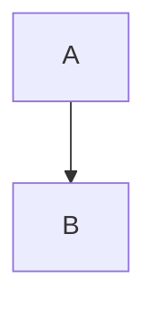
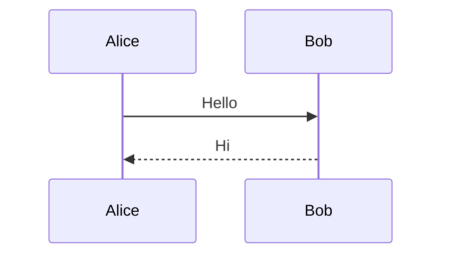

# Google Docs integration

Scrybe can export a Markdown document to a native Google Doc in your Drive and
import a Google Doc back to Markdown. Mermaid diagrams travel as PNGs that
carry their own source (in the PNG's iTXt metadata and in the image alt text),
so a round trip brings the ```` ```mermaid ```` fences back.

Scrybe asks Google for the **`drive.file`** scope only: it can see and edit
just the files it created, which it keeps in a **Scrybe** folder in My Drive.
Nothing else in your Drive is visible to it. You can move that folder
anywhere (keep its name) and Scrybe keeps using it; docs you move into a
shared drive stay linked and are updated in place.

## One-time setup: bring your own OAuth client

Scrybe does not ship a Google client id. You create one in your own Google
Cloud project (free, about five minutes) and give it to Scrybe:

1. Open <https://console.cloud.google.com/> and create a project (any name,
   e.g. `scrybe`).
2. **APIs & Services ▸ Library**: enable the **Google Drive API**.
3. **APIs & Services ▸ OAuth consent screen**: choose **External**, fill in
   the app name (`Scrybe`) and your email, save. Leave the app in **Testing**
   and add your own Google account under **Test users**. (Testing mode is all
   you need for `drive.file`; no verification review is required.)
4. **APIs & Services ▸ Credentials ▸ Create credentials ▸ OAuth client ID**:
   application type **Desktop app**, name `Scrybe`. Download the JSON.
5. Save that file as `client.json` in Scrybe's Google config directory:

   | Platform | Path |
   |---|---|
   | macOS | `~/Library/Application Support/scrybe/google/client.json` |
   | Linux | `~/.config/scrybe/google/client.json` |
   | Windows | `%APPDATA%\scrybe\google\client.json` |

   The downloaded file (`{"installed": {"client_id": …, "client_secret": …}}`)
   is accepted as-is. Alternatively set `SCRYBE_GOOGLE_CLIENT_ID` and
   `SCRYBE_GOOGLE_CLIENT_SECRET` in the environment (both, or they are
   ignored), or point `SCRYBE_GOOGLE_DIR` at a different directory.
   `scrybe gdoc status` prints the directory it is using in every state
   (`scrybe gdoc status --json` exposes it as `config_dir`).

   The client secret is a credential: keep it out of git (PRIVACY.md).
   Replacing `client.json` (or the env vars) with a different OAuth client
   invalidates the cached token; run `scrybe gdoc login` again.

6. Sign in once:

   ```bash
   scrybe gdoc login
   ```

   A browser tab opens for Google's consent screen; after you approve, the
   tab says you can close it and the terminal prints `Signed in`. (The
   command waits up to five minutes for the consent page.) The token is
   cached next to `client.json` as `token.json` (mode 0600) and refreshed
   automatically. `scrybe gdoc logout` revokes and removes it;
   `scrybe gdoc status` reports the current state without talking to Google
   and exits 0 when signed in, 1 otherwise, so a script can branch on it
   (`--json` prints `{status, expires_at, config_dir}`).

## Using it

- **App**: the ☁️ **Google Docs** toolbar button (or File ▸ Export to Google
  Docs…) exports the active tab. File ▸ Import from Google Docs… lists the
  docs Scrybe created and writes the chosen one as a new `.md` tab.
  File ▸ Google Docs ▸ **Sign in to Google…** / **Sign out of Google** are
  the app's `scrybe gdoc login` / `logout`.
- **CLI**: `scrybe gdoc export notes.md` prints the doc URL (`--title` names
  the doc, `--json` prints the full report); `scrybe gdoc list` prints the
  docs Scrybe created, newest first; `scrybe gdoc import <doc id or URL>
  --out notes.md` writes Markdown (`--json` for the report);
  `scrybe gdoc login` / `logout` / `status` manage the sign-in (each takes
  `--json` for `{status, expires_at, config_dir}`).
- **MCP**: the `gdoc_auth`, `gdoc_list`, `gdoc_export`, and `gdoc_import`
  tools are the agent-side twins of the above (see AGENTS.md). They need no
  running app, only the sign-in; `gdoc_auth` with `action: "login"` opens
  the browser on the machine running the MCP server, so an agent should
  check `status` and ask you to sign in rather than call `login` unattended.

The first export of a file creates the doc and writes a sidecar
`<name>.gdoc.json` beside it; later exports update that same doc in place, so
its URL and sharing settings survive. The sidecar holds the doc id and URL,
the Drive folder, the time and content hash of the last export, and a
manifest of every Mermaid diagram (source, SHA-256, uuid). The doc's name
follows the Markdown's first H1 (the file name when there is none) unless
you renamed it in Drive or passed `--title`. Delete the sidecar to force a
fresh doc; if the linked doc was trashed or deleted, the next export creates
a new one anyway.

Local images are copied into the Doc only when they are files under the
Markdown's own directory (subfolders are fine). `../` paths, absolute paths
and missing files are left as written, which Google shows as broken images;
`scrybe gdoc export` prints how many on stderr, `--json` and the
`gdoc_export` result list them in `images_skipped`, and the app's toast
carries the count. `http(s)` image URLs are left for Google to fetch.

Export takes a Markdown file (`.md`, `.markdown`, `.mdown`, `.mkd`, `.mkdn`,
`.mdx`; a bare `.mmd` diagram exports as a one-figure doc) and refuses
anything else, so no sidecar is ever written beside an image or a source
file. It also refuses a symlinked sidecar, and import refuses a symlinked
output, sidecar or `<name>_img_NN` target (`invalid_argument`, before any
Google request): those names are predictable, and a pre-planted link would
redirect the write to a file you never named.

Import writes the Markdown to the output path (a `.md` or `.markdown` file
in a directory that already exists), any non-Mermaid images beside it as
`<name>_img_NN.<ext>`, and a sidecar linking that file to the doc, so
exporting the file later updates the doc you imported from. Pass a bare doc
id or any `docs.google.com` / `drive.google.com` URL for it.

## How the diagrams survive

Each Mermaid fence is rendered to a PNG whose iTXt metadata carries the
source, a uuid and the source's SHA-256 (the same payload `scrybe mermaid`
and the `mermaid_to_png` tool embed). The same payload goes into the image's
alt text (`scrybe-mermaid:v1:…`) and into the sidecar's manifest. Google may
re-encode images and drop the PNG metadata; Scrybe then recovers the diagram
source from the Markdown export's image alt text, then from the sidecar
beside the file you import into — which only counts when that sidecar names
the same doc, i.e. when you import back over the file you exported — and
consults the HTML export's alt text (which Google sometimes keeps when its
Markdown export drops it) only when there is no such sidecar. The per-figure
`verification` in `gdoc_import`'s result (and in `scrybe gdoc import
--json`) tells you which carrier was used:

| `verification` | Meaning |
|---|---|
| `verified` | PNG metadata intact and its SHA-256 matched the source |
| `unverified` | PNG metadata present but without a digest, or the digest did not match |
| `alt-text` | PNG metadata gone; source recovered from the image alt text |
| `manifest` | PNG metadata and the Markdown export's alt text gone; source recovered from the sidecar manifest |

The recovered source is exact in every case. An image with none of the three
carriers is written out as an ordinary image file.

## When it fails

The CLI prints the message and exits non-zero; over MCP the result is
`isError: true` with the code in `structuredContent.code`.

| Code | Meaning | What to do |
|---|---|---|
| `not_configured` | No OAuth client: neither `SCRYBE_GOOGLE_CLIENT_ID`/`SCRYBE_GOOGLE_CLIENT_SECRET` nor a readable `client.json` in the config directory | Do the one-time setup above. `scrybe gdoc status` prints the directory it looked in (`--json`: `config_dir`). |
| `not_logged_in` | No cached token, or Google rejected it (revoked, expired, or the OAuth client changed since it was issued) | `scrybe gdoc login` (or the app's Sign in to Google…). |
| `doc_not_found` | Drive returned 404: the id is wrong, the doc was deleted, or Scrybe did not create it and so cannot see it under `drive.file` | Check the id against `scrybe gdoc list`. A doc made elsewhere is out of reach by design; use Google Docs' own File ▸ Download ▸ Markdown for it. |

Other codes: `invalid_argument` (not a doc id or URL; a malformed or
symlinked sidecar; a path that is not a Markdown file or a symlinked target),
`auth_failed` (consent denied, cancelled, or timed out), `api_error` and
`http_error` (Google or the network; retry), `render_failed` (a Mermaid
diagram did not render — fix the diagram), `io_error` (a file or sidecar
could not be read or written; an export that uploaded but could not write
its sidecar names the doc id and URL so you can still find it).

## Verifying the round trip

````bash
scrybe gdoc login            # once; opens the browser
scrybe gdoc status           # Signed in (token expires 2026-…; config ~/Library/Application Support/scrybe/google)

cat > roundtrip.md <<'EOF'
# Round trip



Text between the diagrams.


EOF

scrybe gdoc export roundtrip.md --json
# {"path":"roundtrip.md","doc_id":"1Ab…","url":"https://docs.google.com/document/d/1Ab…/edit…",
#  "folder_id":"…","action":"created","figures":2,"images_skipped":[]}

scrybe gdoc import "https://docs.google.com/document/d/1Ab…/edit" --out roundtrip-back.md --json
# {"path":"roundtrip-back.md","doc_id":"1Ab…","diagrams":2,"images":0,
#  "figures":[{"index":0,"verification":"verified"},{"index":1,"verification":"verified"}],
#  "image_paths":[]}

grep -c '^```mermaid' roundtrip-back.md    # 2
````

`diagrams` must be 2, and each `verification` `verified` (or `alt-text` if
Google re-encoded the PNGs; the source is exact either way). The prose
around the fences may differ slightly from the original (see Limitations);
the diagram source comes back as written. Exporting `roundtrip.md` a second
time reports `"action":"updated"` with the same `doc_id`. Over MCP the same
sequence is `gdoc_auth` (`status`), `gdoc_export`, `gdoc_import`, reading
`structuredContent.figures[].verification`.

## Limitations

- Math (KaTeX) is passed through as plain text.
- Table and code-block fidelity depends on Google's HTML import.
- Google's Markdown export backslash-escapes some punctuation; Scrybe does not
  undo that outside Mermaid fences (whose source comes from the PNG payload,
  the alt text, or the manifest).
- Updating a doc in place replaces its content, so comments anchored to old
  text are lost.
- With `drive.file`, import and `scrybe gdoc list` only see docs Scrybe
  created.
