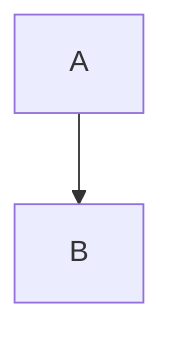

```plaintext
x < y && "a"
```

```
x < y && "a"
```

    x < y && "a"



```xyzzy
x < y && "a"
```

# Hello, *World*! &amp; `code`

# Hello, *World*! &amp; `code`

# Hello, *World*! &amp; `code`-1

# Café Über 日本語 é Ⅷ ‿ 😀

# Café Über 日本語 é Ⅷ ‿ 😀

# !!!

# !!!

# A  B

# "Quotes" -- and ... dots

```
```

```mermaid
```

```Ruby
x
```

# A²B &#x200d; [link](url)

# ΟΣ

# ΑΣ

# ΟΣ

# İ K ẞ
